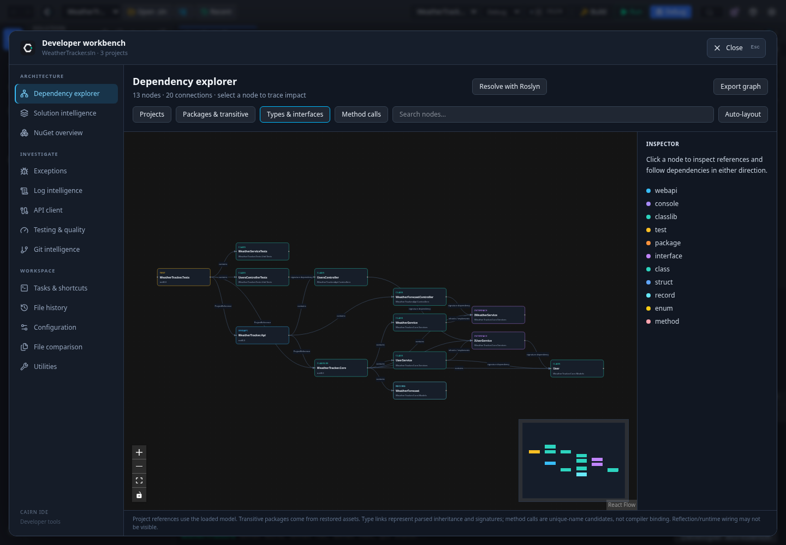

# Advanced developer tools

Open **Developer workbench** from the editor. Tools are grouped in a navigation rail; **Close** and **Escape** dismiss the workbench. The workbench sits below the native title-bar region. The toolbar stays on one row and collapses secondary labels at narrower widths.

## Dependency and solution intelligence

- **Dependency explorer:** draggable nodes, zoom/pan, minimap, auto-layout, search, JSON export, node inspector, source navigation and transitive impact in both directions.
- **Projects:** loaded project references. **Packages & transitive:** package declarations plus actual resolved dependencies loaded from each project's `obj/project.assets.json`. Restore projects before loading assets.
- **Types & interfaces / Method calls:** initially provide parsed inheritance/signature links and explicitly labeled unique-name call candidates.
- **Resolve with Roslyn:** evaluates the selected solution/project with MSBuild and builds compiler-resolved source-type, interface, inheritance and call relationships. Requires .NET SDK 8+ and a restored target. The bundled helper is compiled/restored into the local application profile on first use. Compiler/load diagnostics remain visible; an errored or partially loaded solution is not reported as fully resolved. New solution formats require a compatible SDK. Metadata-only symbols, dynamic/reflection wiring and configurations that were not loaded are not expanded.
- **Solution intelligence:** project relationship/health cards, cycle flags, unresolved references, interface implementations, framework compatibility checks, unused-project candidates and architecture relationships. Add local architecture constraints to flag prohibited direct or transitive dependencies.
- Unused-project candidates are unreferenced class libraries, not removal instructions. Framework rules cover common TFMs and report unknown cases; compiler/restore results remain authoritative. The interface summary uses the parsed index; the Roslyn graph provides compiler-resolved implementation edges.

## API testing client

- Build REST requests with method, URL, JSON headers and body. GraphQL sends query plus variables using HTTP POST.
- Test gRPC unary, server-streaming, client-streaming and bidirectional methods. Supply a self-contained proto, service, method and host:port. Client streaming uses a finite JSON array; server output is collected up to the time/message/size limits. External proto imports are not resolved from arbitrary filesystem paths.
- WebSocket connect/send/receive/disconnect with bounded session transcripts and optional vault bearer authentication.
- Named session environments substitute `{{variable}}` in requests. Named request collections are stored locally per workspace. Recognized authentication headers are cleared on save; review URLs and bodies before persisting them. Environment values and response history remain session-only.
- Request history supports replay/editing and side-by-side response comparison. JSON responses have an expandable viewer. Individual timings and session min/median/p95/max provide response-time analysis.
- The authentication token manager uses Electron OS encryption, stores encrypted values locally, lists names only and refuses plaintext fallback. Tokens are referenced by name. This is bearer-token management, not an OAuth authorization server/refresh implementation.
- Run a selected collection sequentially with HTTP status, maximum duration and optional typed JSON-pointer assertions. Cancel stops the active request and remaining collection. WebSocket sessions are tested interactively rather than by the collection runner.
- Redirects are displayed rather than automatically followed. HTTP bodies are limited to 1 MB requests/2 MB responses; HTTP requests have bounded timeouts. gRPC calls have a 15-second deadline and bounded messages; WebSocket payloads/transcripts are bounded. Requests run in the desktop process and intentionally support local/private development endpoints. They are not a remotely exposed proxy.

## Log intelligence

- Combine retained run/debug output, imported service logs and multiple native live file streams, each with a source name. File streams follow appends, truncation and rename/replacement rotation; stop streams individually through closing the tool or together with the Stop control.
- Inspect structured JSON/common Serilog fields and plain text; search, filter levels/correlation IDs, and group by source, level or trace.
- Group exceptions and navigate recorded stack locations. Follow a request lifecycle as ordered recorded events with the same explicit trace/correlation ID. Uninstrumented services cannot be linked automatically.
- Compare two source snapshots with a read-only diff, visualize levels with colors and export filtered JSON reports. Export redaction handles recognized secret keys and bearer patterns; review reports before sharing because pattern redaction is not exhaustive.
- Imports/source buffers/rendered rows are bounded. Sources and session data are not uploaded. Close the tool to release file watchers.

## Git intelligence

- Native commit graph with decorations, working-tree status, branch list and connectivity health check.
- Stage/unstage a file; inspect and stage individual textual hunks or validate an edited unified patch. Paths stay within the repository and commands use argument arrays.
- Compare branch changes, inspect commit file impact and follow a file's history.
- Inspect merge base/ours/theirs and a working resolution; explicitly confirm writing/staging the resolved file.
- Preview and reorder an interactive rebase plan (pick/drop/squash/fixup), apply it with a clean working tree, and continue/abort conflicts. Plans are limited to 30 commits. No force push is performed.
- Preview merged branches and confirm deletion with Git's merged-branch guard. Workspace change snapshots use Git stash including untracked files; applying a snapshot retains the stash.
- Destructive/history-changing operations show native confirmation. Inspect what Git reports before continuing; repository hooks/configuration are executable project tooling.

## Testing and quality center

- The Tests sidebar retains discovery, project grouping, individual/group/all/failed-test execution and debugging.
- The center runs actual `dotnet test`, captures TRX results, pass/fail details, test durations, overall execution timing and a bounded persistent run history with failed tests.
- Run tests with `XPlat Code Coverage` or import a Cobertura report; inspect line/branch percentages and navigate covered/uncovered source lines. Coverage runs require a compatible collector such as `coverlet.collector`; missing tooling is reported rather than silently editing dependencies.
- Run compiler/analyzers and inspect emitted diagnostics, including unused/dead-code warnings supported by the compiler/installed analyzers. No assertion is made that externally consumed public symbols are unused.
- Syntax-based decision counts/body lengths and exact normalized eight-line duplicate windows provide review candidates. They are not compiler control-flow proofs and may overlap.
- Formatting validation uses `dotnet format --verify-no-changes` and leaves source unchanged.
- Test impact reads changed Git paths or accepts paths, follows reverse project dependencies and suggests dependent test projects. Shared solution/build/config changes select all relevant tests. This is conservative project-level impact, not per-test coverage-based selection.
- Quality runs require execution confirmation, have a timeout and can be cancelled. Reports are local and can contain source paths/tool output.

## Utilities

JSON format/validation, XML format/validation without DTD/entities, YAML validation with alias limits, worker-isolated regex testing, unverified JWT decoding, UTF-8 Base64, SHA-256, UUID, cron next-run inspection in UTC, Unix-seconds conversion and URL component encoding/decoding are local tools. Regex matching uses JavaScript syntax and is terminated after 500 ms if necessary.

Desktop utilities inspect a pasted PEM certificate, listening ports/port availability, process CPU/memory snapshots, and folder sizes/top files. Certificate metadata is not a chain/revocation trust verdict. Size scans skip symlinks, cap traversal and disclose truncation.

## Verification

`npm test` runs unit and real local protocol/Git/system integration tests. `npm run test:ui` builds and checks toolbar layout, actual C# token colors, graph layers/inspection, Close/Escape and regex isolation in Chromium. `CAIRN_DOTNET_INTEGRATION=1 node --test tests/dotnet.integration.test.cjs` exercises real .NET tests/coverage/analyzers/formatting/history and Roslyn resolution of a `.slnx` fixture. CI has separate core, browser and .NET jobs.

Packaged macOS acceptance remains necessary for native drag hit-testing, Keychain encryption, icons, Finder navigation, native terminals and SDK discovery. Browser checks and Linux integrations do not establish those macOS-specific behaviors.
